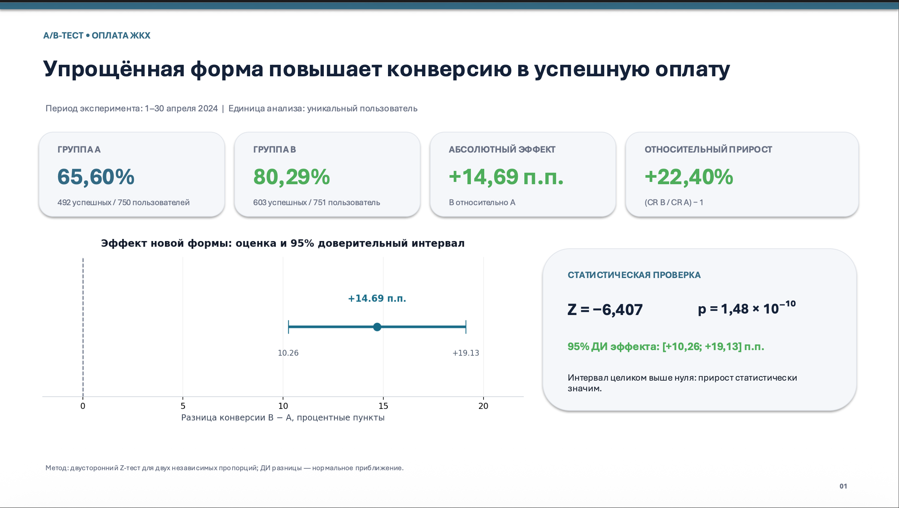
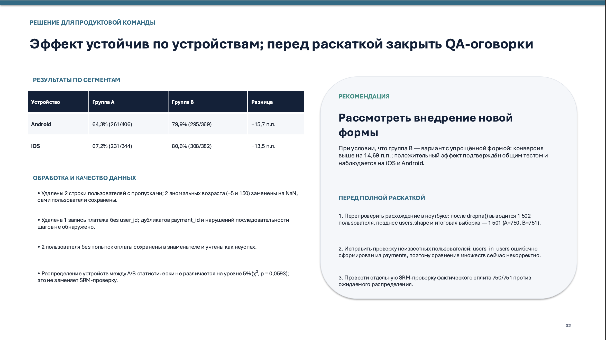

# A/B-тест: упрощение формы оплаты ЖКХ

## Описание проекта

### Бизнес-кейс

Продуктовая команда протестировала новую, упрощённую форму оплаты услуг ЖКХ. Цель эксперимента — проверить, помогает ли изменение интерфейса увеличить долю пользователей, успешно завершающих оплату.

Необходимо сравнить конверсию контрольной и тестовой групп, оценить величину эффекта и определить, есть ли статистические основания рекомендовать внедрение новой версии формы.

### Данные и эксперимент

- **Период:** апрель 2024 года.
- **Единица распределения:** клиент.
- **Группа A (Control):** пользователи старой формы оплаты.
- **Группа B (Test):** пользователи упрощённой формы оплаты.
- **Размер итоговой выборки:** 1 501 пользователь.

## Ход анализа

### 1. Предобработка данных

- Обработка пропусков и аномальных значений.
- Проверка дубликатов идентификаторов платежей.
- Проверка последовательности этапов оплаты.
- Пользователи без попыток оплаты сохранены в выборке и учитываются как не совершившие успешную оплату.

### 2. Расчёт продуктовой метрики

- Основная метрика — **Conversion Rate (CR)**, доля пользователей, успешно завершивших оплату.
- Сравнение конверсии между контрольной и тестовой группами.
- Дополнительный анализ результатов в разрезе устройств (Android и iOS).

### 3. Статистический анализ

- Двусторонний Z-тест для двух независимых пропорций.
- Проверка статистической значимости различий.
- Расчёт 95% доверительного интервала для разницы конверсий.

## Результаты A/B-теста

| Метрика | Группа A | Группа B |
|---|---:|---:|
| Количество пользователей | 750 | 751 |
| Успешные оплаты | 492 | 603 |
| Конверсия (CR) | 65,60% | 80,29% |

### Ключевые результаты

- **Абсолютный прирост конверсии:** +14,69 п.п.
- **Относительный прирост конверсии:** +22,40%.
- **Z-статистика:** −6,407.
- **p-value:** 1,48 × 10⁻¹⁰.
- **95% доверительный интервал разницы конверсий (B − A):** [+10,26; +19,13] п.п.

Полученное p-value значительно ниже уровня значимости 0,05. Доверительный интервал разницы конверсий не включает ноль. Следовательно, в рамках проведённого эксперимента обнаружено статистически значимое увеличение конверсии в тестовой группе.

## Анализ по устройствам

Положительная динамика наблюдается в обоих сегментах:

| Устройство | CR группы A | CR группы B | Прирост |
|---|---:|---:|---:|
| Android | 64,3% | 79,9% | +15,7 п.п. |
| iOS | 67,2% | 80,6% | +13,5 п.п. |

Результаты сегментации согласуются с общим результатом эксперимента: увеличение конверсии наблюдается как среди пользователей Android, так и среди пользователей iOS.

## Бизнес-вывод

Упрощённая форма оплаты показала положительный результат: конверсия в успешную оплату увеличилась с 65,60% до 80,29%, а относительный прирост составил 22,40%.

Различия между группами статистически значимы. На основании полученных результатов можно рекомендовать продуктовой команде рассмотреть внедрение новой формы оплаты.

Перед полным масштабированием рекомендуется дополнительно проверить корректность распределения пользователей по группам и оценить влияние изменения на другие показатели пользовательского опыта, например количество ошибок при оплате и время прохождения формы.

## Используемые инструменты

- Python
- Pandas, NumPy
- SciPy
- Matplotlib
- Jupyter Notebook

## Материалы проекта

- [Jupyter Notebook с анализом](./AB-TEST-TBANK.ipynb)

## Презентация результатов

### Слайд 1. Основные результаты A/B-теста

### Слайд 2. Сегментация и рекомендации

